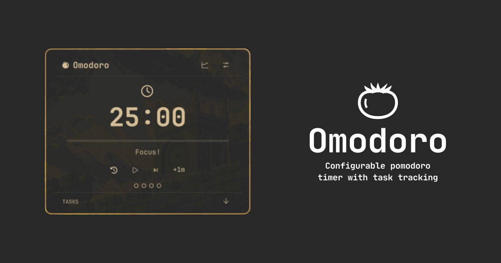

# Omodoro



Pomodoro technique timer and task tracker [quickshell](https://quickshell.org/) plugin for [Omarchy](https://github.com/omarchy)

[Plugin page on Omarchy plugin marketplace](https://omarchyplugins.com/plugin.html?id=pnkm0nk.omodoro)

## Features
- Create goals for your pomodoro sessions and track progress
- View your stats
- Choose between presets or create your own
- Customizable work/short break/long break intervals 
- Track your progress with stats
- Enable/disable notifications if you need them
- Enable/disable sound, with a choice of alert sound for work/break transitions and an optional ticking clock while a session runs
- A small .json persistence file to preserve the stats, config and tasks

## Install

```sh
omarchy plugin add https://github.com/Pnkm0nK/Omodoro --enable
```

Move it on the bar using `--section right`, `--section left` or `--section center`:

```sh
omarchy bar move pnkm0nk.omodoro --section center
```

## Remove

```sh
omarchy plugin remove pnkm0nk.omodoro
rm -rf ~/.local/state/omarchy/omodoro.json
```
## Shortcuts

When the panel is open and focused:

| Key | Action |
| --- | --- |
| `Space` / `Enter` | Start / Pause timer |
| `r` / `R` | Reset current session |
| `n` / `N` | Skip to next session |
| `+` / `=` | Add 1 minute |
| `-` / `_` | Subtract 1 minute |
| `Esc` | Close panel |

## Omarchy keybind
If you would like to open the panel using a keyboard shortcut, you can add the following line to `$HOME/.config/hypr/bindings.lua`: 
```lua
o.bind("SUPER + SHIFT + P (Or your preffered keybind)", "Omodoro", "omarchy shell -q shell toggle pnkm0nk.omodoro")
```

## Adjusting sound volume

The bundled sounds in `sounds/` (used for Ticking) are already normalized so their peaks
line up with the desktop alert sounds used for the break/work transitions. If you want one
quieter or louder, scale it with `ffmpeg`'s `volume` filter, which takes a linear multiplier
(`1.0` = unchanged, `0.5` = half as loud, `2.0` = twice as loud):

```sh
cd ~/.config/omarchy/plugins/pnkm0nk.omodoro/sounds
ffmpeg -i tick.wav -af "volume=0.5" tick-quieter.wav
mv tick-quieter.wav tick.wav
```

Check the resulting peak level any time with:

```sh
ffmpeg -i tick.wav -af volumedetect -f null - 2>&1 | grep max_volume
```

The shipped clips sit around -17 dBFS peak (roughly 20% of full scale) — well below the
desktop alert sounds' -3 to -10 dBFS, since a tick plays every second while an alert plays
once per session.

